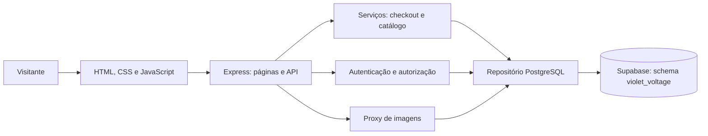

# Violet Voltage: de projeto acadêmico a portfólio

## Problema e objetivo

A primeira versão dependia de recursos Azure disponibilizados para a atividade
acadêmica. Quando esse acesso terminou, o código e o frontend continuavam
disponíveis, mas a aplicação perdeu sua persistência. O objetivo passou a ser
restaurar o site com infraestrutura controlada pelo autor e evoluir a experiência
para demonstrar desenvolvimento full stack, sem operar uma loja real.

O catálogo foi reconstruído a partir do manifesto e das 22 imagens locais.
Isso não recupera os clientes ou pedidos do banco anterior: sem exportação,
esses registros não podem ser recriados a partir do código.

## Arquitetura atual

O Express é hospedado no Render. Somente o backend conhece a conexão PostgreSQL.
O frontend usa a API da aplicação; não consulta a Data API do Supabase nem
recebe credenciais do banco. O modo em memória existe para desenvolvimento e
demonstrações descartáveis; a configuração o proíbe em produção.

## Decisões e contrapartidas

| Decisão | Motivo | Limite assumido |
| --- | --- | --- |
| Manter Express e JavaScript sem frameworks | Preservar a base e concentrar o trabalho na experiência e persistência | Organização de estado e componentes exige disciplina própria |
| Adaptador PostgreSQL com contrato de repositório | Trocar infraestrutura sem reescrever todas as rotas | Nomes como partitionKey e etag permanecem como compatibilidade |
| Registros JSONB com chaves, versões e restrições SQL | Preservar o formato dos dados durante a migração | Não é um modelo relacional totalmente normalizado |
| Imagens em bytea | As 22 fontes somam cerca de 3,28 MB; um serviço de dados basta para a demonstração | Não é a escolha proposta para um grande catálogo de mídia |
| Autenticação própria existente | Manter bcrypt, cookie HttpOnly e autorização backend | Recuperação de senha e revogação completa de sessões não foram implementadas |
| Testes PostgreSQL via PGlite | Testar SQL e rollback sem credenciais cloud no CI | Não reproduz rede TLS, infraestrutura hospedada ou múltiplas instâncias |

## Integridade do pedido

O navegador envia IDs e quantidades. O servidor relê os produtos, verifica
disponibilidade e calcula subtotal e frete em centavos inteiros. Valores
monetários enviados pelo cliente não determinam o preço final.

No PostgreSQL, baixa de estoque e criação do pedido fazem parte da mesma
transação serializável. Uma falha reverte ambas. Versões detectam atualizações
concorrentes e erros de serialização têm tentativas limitadas. O identificador
requestId, combinado com o cliente, permite devolver um pedido já registrado.

Isso não equivale a uma garantia financeira de processamento exatamente uma
vez sob toda falha distribuída. O projeto não integra gateway, cobrança, frete
real ou infraestrutura de conciliação. Cancelamento de status não repõe estoque
automaticamente.

## Evolução da experiência

As melhorias locais incluem identidade visual musical, filtros removíveis,
ordenação, parâmetros compartilháveis na URL e dados do produto organizados.
O trabalho de acessibilidade inclui foco ao confirmar pedido, fechamento do
menu com Escape e filtros recolhíveis em telas pequenas.

Falhas recebem ações de recuperação: consultar histórico novamente, recarregar
carrinho e tentar consultar produto. Falha de rede ao verificar sessão é
diferenciada de ausência de autenticação. Se o pedido foi salvo, mas a limpeza
do carrinho local falhou, a confirmação permanece visível.

Essas funcionalidades estão implementadas localmente; a revisão visual e das
interações ainda está pendente. Não se afirma conformidade formal de
acessibilidade ou publicação de todas as melhorias.

## Evidências e limites da validação

- Última suíte completa observada: 33 testes aprovados e lint aprovado.
- Cobertura inclui autenticação, autorização, checkout, estoque, imagens, seed,
  rollback PostgreSQL e testes de cliente para falhas de comunicação/carrinho.
- Seed cloud confirmado com 22 produtos e 22 imagens legíveis em nova conexão.
- Funcionamento da versão migrada no Render confirmado pelo autor.
- Workflow de CI preparado; primeira execução real no GitHub ainda pendente.
- Sem medições publicadas de desempenho, auditoria visual completa ou testes
  de carga. Os resultados automatizados não substituem essas verificações.

Resultados históricos e limites estão em [VALIDACAO.md](../VALIDACAO.md).
O [roteiro de demonstração](DEMONSTRACAO.md) orienta uma apresentação com dados
fictícios, incluindo o painel sem divulgar acesso administrativo.

## Próximos marcos

Concluir revisão visual, mobile e fluxos; registrar evidências; executar o CI
remoto após envio autorizado e publicar a versão revisada. Agentes serão uma
etapa posterior, com função, permissões, custo e avaliações definidos antes da
implementação. Não fazem parte das capacidades atuais do site.
